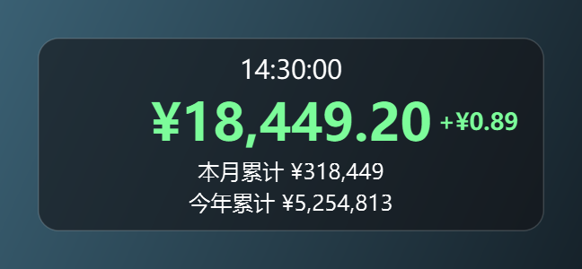
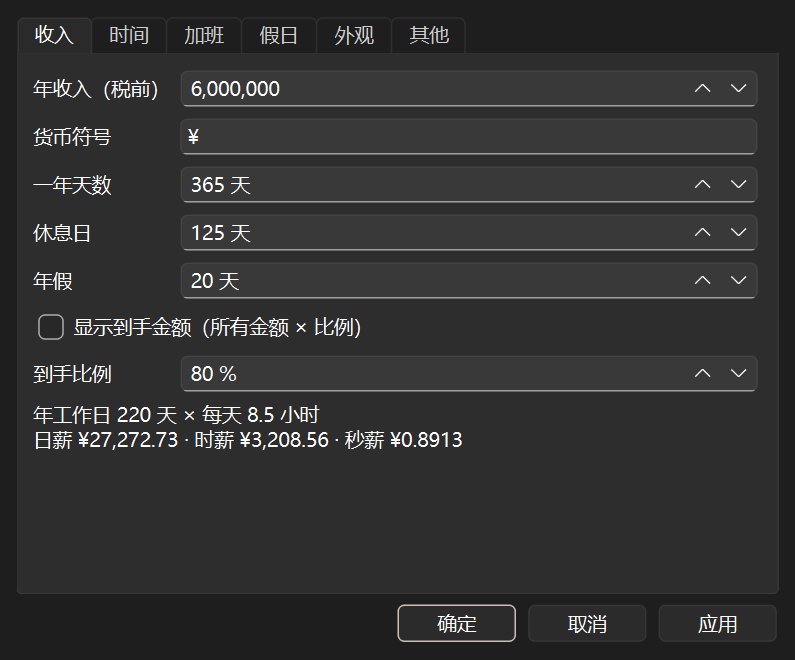
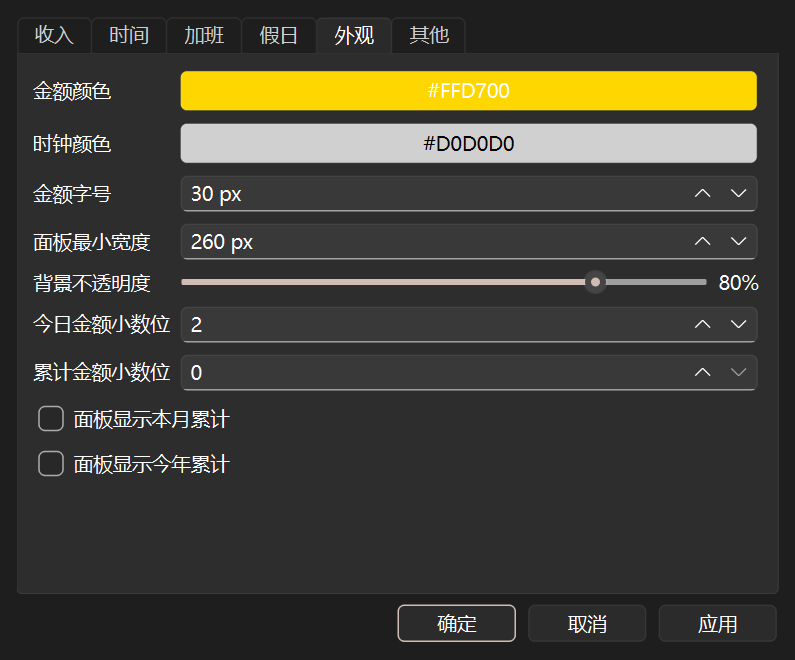

# EarnTicker

An always-on-top floating panel for Windows that shows how much you have earned today,
second by second. Enter your annual income once; the panel ticks up every second with a
small `+¥0.89` that floats up and fades out.

Single portable `.exe`, fully offline, no installer, no admin rights, no registry writes.

| Working (14:30) | Overtime (18:30) | Rest day | Custom colours + totals |
|---|---|---|---|
|  |  |  |  |

 

*(Screenshots use example data: annual income ¥6,000,000.)*

## How pay is calculated

```
working_days = days_in_year − rest_days − annual_leave_days      (365 − 125 − 20 = 220)
daily_hours  = end − start, no lunch deduction                   (08:45–17:15 = 8.5 h)
daily        = annual_income / working_days
hourly       = daily / daily_hours
per_second   = hourly / 3600
```

Worked example, annual ¥6,000,000: daily **¥27,272.73**, hourly **¥3,208.56**,
per second **¥0.8913**. On a weekday at 14:30 you have earned
20,700 s × 0.891266 = **¥18,449.20**. Full hand calculation: [docs/HAND_CALC.md](docs/HAND_CALC.md).

* **Regular pay** accrues linearly from start to end on work days (0 before start, capped
  at `daily` from the end time).
* **Work day vs rest day**: a day is a rest day if its weekday is not a selected work weekday
  *or* it is in the holiday list. (`rest_days` = 125 is only used for the rate.)
* **Overtime** = hourly × coefficient (all editable, they never stack):

  | | Daytime | Late night 22:00–05:00 |
  |---|---|---|
  | Work day | 1.25 | 1.5 |
  | Rest day / holiday | 1.35 | 1.6 |

  * *Auto overtime* (default on): on work days overtime accrues from the end time until you
    press 「结束加班」, **capped at 3 h** (「自动加班上限」, 0–12 h; default 17:15 → 20:15).
    After the cap the panel no longer shows 「加班中」.
  * *Manual* 「开始加班 / 结束加班」 from the panel's right-click menu or the tray menu;
    multiple sessions per day, **not capped**; persisted so restarts don't lose them. Seconds
    inside regular hours or already covered by another session are never paid twice; a
    session started during regular hours counts from the end time (status
    「已开始加班（17:15 起计）」).
  * Overtime is accounted per calendar day and stops at local midnight. If the app is running
    at midnight with a manual session open, the session continues on the new day.
  * For past days (and when the PC slept across midnight), anything still running counts only
    until the last moment EarnTicker was seen running that day (recorded once per minute,
    + 60 s) — never up to midnight while the PC was asleep.
* **Take-home ratio** (optional, default off, 80 %): multiplies every displayed amount.
* **Month-to-date / year-to-date** (optional lines; month is always shown on rest days):
  completed work days × daily + recorded overtime + today.

## Panel

* Line 1: live clock `HH:MM:SS`; line 2: today's earnings (gold, 2 decimals, updates every
  second aligned to the wall clock).
* Status line: 「还没上班」 before start, 「加班中 ×1.25 · 其中加班 ¥…」 while overtime is
  accruing, 「已开始加班（17:15 起计）」 for a manual session started during work hours,
  「已下班」 after work, 「今天休息」 + month total on rest days.
* Drag with the left mouse button (position is remembered). Right-click: 设置… /
  开始·结束加班 / 收起到托盘 / 退出.
* Tray icon (gold coin): left-click shows/hides the panel; menu 显示/隐藏, 开始/结束加班, 设置…, 退出.

## Settings

All changes preview on the panel immediately; 确定/应用 saves them, 取消 reverts.

| Setting | Default |
|---|---|
| Annual income (pre-tax), currency symbol | 6,000,000 (example), `¥` |
| Days in year / rest days / annual leave | 365 / 125 / 20 (computed working days and daily / hourly / per-second rates shown live) |
| Start / end time | 08:45 / 17:15 |
| Work weekdays | Mon–Fri |
| Holiday list | empty; add/remove dates, import a JSON file, or 「导入日本假日（2026–2027 示例）」 (bundled `config/holidays.example.json`) |
| Auto overtime, cap | on, 3 h after the end time (0–12 h, step 0.5) |
| Coefficients: weekday / weekday late night / rest day / rest-day late night | 1.25 / 1.5 / 1.35 / 1.6 (1–10) |
| Take-home ratio | off, 80 % |
| Amount colour / clock colour | `#FFD700` / `#D0D0D0` |
| Amount font size, minimum panel width | 30 px, 260 px |
| Background opacity | 80 % |
| Decimals: today / totals | 2 / 0 |
| Show month / year totals | off / off |
| Start with Windows | off (creates `EarnTicker.lnk` in `%APPDATA%\Microsoft\Windows\Start Menu\Programs\Startup`; on every start of the exe the shortcut is re-pointed at the current exe location) |

On first run (no settings file) the example values are used and the Settings dialog opens
so you can enter your own income.

### Where settings are stored

* `earnticker_settings.json` and `earnticker_state.json` (overtime sessions) live **next to
  `EarnTicker.exe`** (portable).
* If that folder is not writable, or when running from source, they go to
  `%APPDATA%\EarnTicker\`.
* `--config-dir DIR` overrides the location.
* A corrupt JSON file is backed up as `*.json.<YYYYmmdd-HHMMSS>.bak` (never overwritten),
  defaults are used and a one-time notice 「设置文件损坏，已备份并恢复默认」 is shown.
  Files saved with a UTF-8 BOM (e.g. by Notepad) are read fine.
* **OneDrive:** if the exe sits in a OneDrive-synced folder (e.g. Desktop or Documents with
  folder backup on), the settings JSON — including your income — is synced to the cloud.
  Put the exe in a non-synced folder such as `C:\Tools\EarnTicker\`. The 其他 tab of the
  Settings dialog shows the actual path and warns if it contains "OneDrive".

Autostart creates the `.lnk` through a short PowerShell call (WScript.Shell). If PowerShell is
blocked by policy, enabling autostart fails with an error message (the app keeps running).

## Privacy

Fully offline: no network access, no telemetry, no update checks. Your income is stored only
in the local JSON file above. The repository contains example data only.

## Build & test

```powershell
py -3.14 -m venv .venv
.venv\Scripts\python -m pip install -r requirements-dev.txt   # pinned versions
.venv\Scripts\python -m pytest -q          # unit + offscreen UI tests
.venv\Scripts\ruff check .
.venv\Scripts\python -m earnticker         # run from source
powershell -ExecutionPolicy Bypass -File build.ps1   # EarnTicker.spec -> dist\EarnTicker.exe
.venv\Scripts\python tools\make_screenshots.py       # regenerate docs\*.png
.venv\Scripts\python tools\make_icon.py              # regenerate assets\earnticker.ico
```

`EarnTicker.spec` is the only build definition (icon, bundled holiday example); `build.ps1`
just runs it (`-DistPath dist2` builds elsewhere, e.g. while `dist\EarnTicker.exe` is running).

CI (GitHub Actions, `windows-latest`, Python 3.14, versions pinned in `requirements-dev.txt`)
runs ruff + pytest and uploads the built exe as the `EarnTicker-exe` artifact.

Project layout: `earnticker/pay.py` (pure calculation, no Qt), `settings.py`, `state.py`,
`autostart.py`, `ui/` (panel, settings dialog, tray), `tests/`, `tools/`.

## 中文说明

EarnTicker 是一个 Windows 桌面置顶的「时薪悬浮窗」：在设置里填一次年收入（税前），
面板就会每秒显示今天从上班到现在挣了多少钱，每次增加时金额旁边飘出「+¥0.89」。

* 年工作日 = 365 − 休息日 125 − 年假 20 = 220 天；每天 8:45–17:15 共 8.5 小时，不扣午休。
* 时薪 = 年收入 ÷ 220 ÷ 8.5，秒薪 = 时薪 ÷ 3600（年收入 600 万円 → 秒薪约 0.89 円）。
* 加班：下班后自动按系数累加（平日 1.25、平日深夜 22–5 点 1.5、休息日 1.35、休息日深夜 1.6），
  自动加班最多计 3 小时（默认到 20:15，可在设置里改），点「结束加班」提前停止；
  也可在右键菜单或托盘菜单手动「开始/结束加班」，手动加班不受上限限制。
* 电脑在午夜前睡眠、第二天才唤醒时，前一天的加班只算到最后一次检测到程序运行的时刻（+60 秒），不会算到午夜。
* 休息日（周末 + 假日列表）显示「今天休息」和本月累计。可选显示本月/今年累计、到手比例。
* 免安装单个 exe，不联网、不写注册表、不需要管理员权限；设置只保存在 exe 旁边
  （不可写时在 `%APPDATA%\EarnTicker\`）。开机自启默认关闭，开启时通过 PowerShell 在「启动」文件夹
  放快捷方式（PowerShell 被禁用时会提示失败）。
* **注意 OneDrive：** 如果 exe 放在被 OneDrive 同步的文件夹（例如桌面），含年收入的设置文件会被同步到云端。
  建议放到不同步的文件夹，例如 `C:\Tools\EarnTicker\`。设置 →「其他」页会显示实际保存路径，路径含 OneDrive 时会警告。
* 设置文件损坏时会备份为带时间戳的 `.bak` 并恢复默认，同时提示一次「设置文件损坏，已备份并恢复默认」。

## License

MIT
